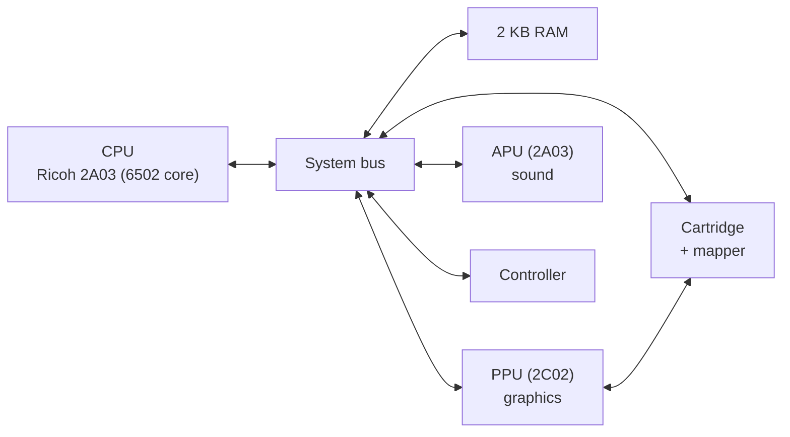

# NES Emulator

**A Nintendo Entertainment System emulator in C++, built by following javidx9's "NES Emulator From Scratch" video series.**

I built this emulator to learn how a real game console works at the hardware level. Following [javidx9](https://www.youtube.com/javidx9)'s *NES Emulator From Scratch* video series, I wrote each component of the console one video at a time over about six weeks, testing as I went: first the CPU, then the memory bus and cartridges, then graphics, and finally sound. The code is based on his [olcNES](https://github.com/OneLoneCoder/olcNES) project

---

## How the NES works (and how the emulator mirrors it)

The emulator is split into the same components as the real console, each one emulated separately and connected through a shared bus.

| Component | File | What it does |
|-----------|------|--------------|
| **CPU** | `olc6502.*` | Emulates the 6502 processor: all official instructions and addressing modes, with cycle counts, so code runs at the right speed relative to the rest of the system |
| **Bus** | `Bus.*` | Routes every CPU read and write to the right device based on its address, and keeps the CPU and PPU clocked in sync (the PPU runs 3 cycles for every CPU cycle) |
| **Cartridge** | `Cartridge.*` | Loads `.nes` ROM files (iNES format), splitting them into program memory and graphics memory |
| **Mappers** | `Mapper_*.cpp` | Real cartridges contained extra chips that switch which part of the ROM the console can see, letting games be larger than the NES's address space. Mappers 000, 001, 002, 003, 004, and 066 are supported, which covers a large share of the NES library |
| **PPU** | `olc2C02.*` | The Picture Processing Unit: renders the background from tile-based name tables and draws up to 64 sprites per frame, scanline by scanline, including scrolling and sprite-zero hit detection |
| **APU** | `olc2A03.*` | The Audio Processing Unit: generates the square-wave sound channels |

## Building and running

The project is set up for **Windows with Visual Studio 2022**.

1. Open `NES Emulator.sln` in Visual Studio.
2. Build and run the project.
3. When prompted, type the path to a `.nes` ROM file.

`nestest.nes` is included. It's a freely distributed test ROM that checks whether the CPU executes every instruction correctly. For games, use ROMs you've dumped from cartridges you own or free homebrew games.

### Controls

| Key | NES button |
|-----|------------|
| Arrow keys | D-pad |
| X | A |
| Z | B |
| A | Select |
| S | Start |
| R | Reset the console |
| P | Cycle through the palettes shown in the debug view |

---

## What I changed

- The emulator asks which ROM file to load at startup instead of loading a hard-coded file
- Lowered the audio volume and adjusted the window scale

---
The emulator code is based on [olcNES](https://github.com/OneLoneCoder/olcNES) by David Barr (javidx9), and the window and sound use his [olcPixelGameEngine](https://github.com/OneLoneCoder/olcPixelGameEngine). Both are distributed under the OLC-3 license:roject is not affiliated with Nintendo.
